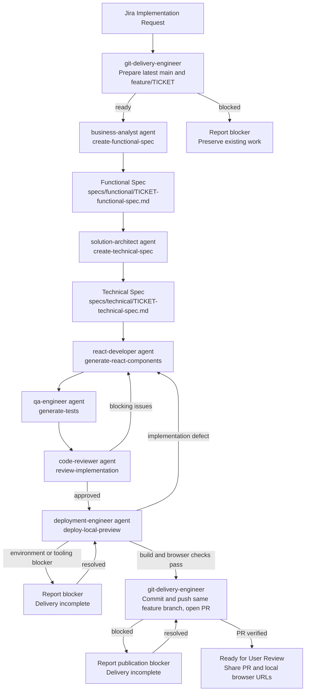

# Workflow: Jira to Code (React UI)

End-to-end workflow that turns a Jira story into reviewed, tested React code, a
browser-verified local preview, and a GitHub PR for user review in the order-ui repository.

## Trigger

A Jira story markdown file is added or updated under `specs/jira/<TICKET-ID>.md`.
Execute this pipeline when asked to implement that story; creating a story file alone
does not authorize implementation, commits, pushes, or PR creation.

Direct feature requests and existing page updates also require the test, review, and
deployment steps below, without requiring Jira specs. Documentation-only changes are
exempt from deployment. These are agent execution instructions, not file-save automation.

## Pipeline

## Steps

0. **Prepare Git** - before any spec-generation or implementation edits,
   `git-delivery-engineer` runs the prepare phase of
   [jira-branch-and-pr](../skills/jira-branch-and-pr/SKILL.md). Require a clean worktree,
   fetch and fast-forward `main` to the confirmed remote, then create
   `feature/<TICKET-ID>`. Preserve dirty work and report blockers rather than switching
   branches with it. Resume existing ticket branches only per the skill's safeguards.
1. **Intake** - `business-analyst` agent reads `specs/jira/<TICKET-ID>.md` and produces a
   functional spec using the `create-functional-spec` skill.
2. **Design** - `solution-architect` agent reads the functional spec and produces a
   technical spec using the `create-technical-spec` skill.
3. **Implement** - `react-developer` agent implements components/hooks/pages per the
   technical spec using the `generate-react-components` skill and templates under
   `templates/`.
4. **Test** - `qa-engineer` agent writes/updates tests using the `generate-tests` skill,
   mapping each acceptance criterion to a test.
5. **Review** - `code-reviewer` agent reviews the implementation and tests using the
   `review-implementation` skill. Blocking issues route back to step 3.
6. **Deploy and Verify** - `deployment-engineer` runs the
   [deploy-local-preview](../skills/deploy-local-preview/SKILL.md) skill: build the current
   source, serve a persistent local preview, and verify changed routes and interactions
   in a browser. Implementation defects return to step 3; environment or tooling blockers
   are reported and must be resolved before completion. If delegation is unavailable,
   execute the skill in the current agent context.
7. **Publish PR** - after tests, review, build, and browser verification pass,
   `git-delivery-engineer` runs the Git delivery skill's publish phase: commit only
   ticket-scoped changes, push the same feature branch, and create or update a PR
   targeting `main`. Verify the PR URL and head SHA. Never merge or force-push.
8. **Ready for User Review** - share the actual PR URL, branch, verification results,
   and exact changed-page preview URLs. Keep the preview running. Publication failures
   are blockers, not completed delivery. Do not treat a PR as merged or released.
   Local preview does not mean public hosting; remote hosting requires explicit
   authorization. For non-Jira UI work, the preview completion rule still applies;
   do not invent a ticket or publish a PR without authorization.

If agent delegation is unavailable, execute the relevant skills in the current agent
context. Documentation-only Jira implementations require applicable local checks and a
PR, but no UI preview.

## File Locations

- Jira stories: `specs/jira/<TICKET-ID>.md`
- Functional specs: `specs/functional/<TICKET-ID>-functional-spec.md`
- Technical specs: `specs/technical/<TICKET-ID>-technical-spec.md`
- Agents: `.claude/agents/`
- Skills: `.claude/skills/`
- Templates: `.claude/templates/`
