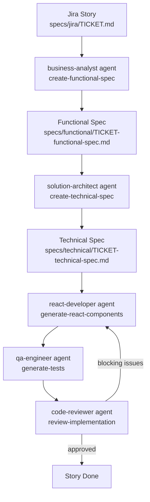

# Workflow: Jira to Code (React UI)

End-to-end workflow that turns a Jira story into reviewed, tested React code in the
order-ui repository.

## Trigger

A Jira story markdown file is added or updated under `specs/jira/<TICKET-ID>.md`.

## Pipeline

## Steps

1. **Intake** - `business-analyst` agent reads `specs/jira/<TICKET-ID>.md` and produces a
   functional spec using the `create-functional-spec` skill.
2. **Design** - `solution-architect` agent reads the functional spec and produces a
   technical spec using the `create-technical-spec` skill.
3. **Implement** - `react-developer` agent implements components/hooks/pages per the
   technical spec using the `generate-react-components` skill and templates under
   `templates/`.
4. **Test** - `qa-engineer` agent writes/updates tests using the `generate-tests` skill,
   mapping each acceptance criterion to a test.
5. **Review** - `code-reviewer` agent reviews the implementation and tests using the
   `review-implementation` skill. Blocking issues route back to step 3.
6. **Done** - once approved, the story is considered implemented and ready for PR/merge.

## File Locations

- Jira stories: `specs/jira/<TICKET-ID>.md`
- Functional specs: `specs/functional/<TICKET-ID>-functional-spec.md`
- Technical specs: `specs/technical/<TICKET-ID>-technical-spec.md`
- Agents: `.claude/agents/`
- Skills: `.claude/skills/`
- Templates: `.claude/templates/`
