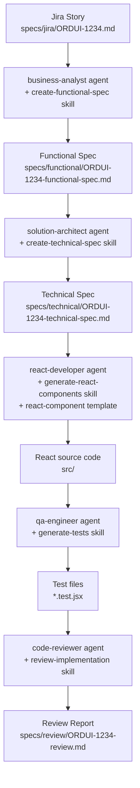

# order-ui

React (plain JavaScript/JSX, no TypeScript) UI for the Order Management system. This
project's entire initial implementation — specs, components, tests, and review — was
generated end to end by an AI coding agent following the `.claude` Jira-to-code workflow.

## The prompt that generated this project

The following single prompt was given to the agent, after the `.claude/agents/`,
`.claude/skills/`, `.claude/templates/`, `.claude/workflows/` structure and the Jira story
[specs/jira/ORDUI-1234.md](specs/jira/ORDUI-1234.md) already existed in the repo:

```
Follow the workflow defined in .claude/workflows/jira-to-code.md to implement Jira story
specs/jira/ORDUI-1234.md end to end in this React JS (no TypeScript) codebase.

Use the agents and skills exactly as defined under .claude/agents/ and .claude/skills/,
in this order:

1. Act as the business-analyst agent (.claude/agents/business-analyst.md) and use the
   create-functional-spec skill (.claude/skills/create-functional-spec/SKILL.md) to turn
   specs/jira/ORDUI-1234.md into specs/functional/ORDUI-1234-functional-spec.md.

2. Act as the solution-architect agent (.claude/agents/solution-architect.md) and use the
   create-technical-spec skill (.claude/skills/create-technical-spec/SKILL.md) to turn the
   functional spec into specs/technical/ORDUI-1234-technical-spec.md. Include the
   suggested use of @tanstack/react-table from the Jira story, the API endpoint
   http://localhost:8080/api/orders, and its response shape.

3. Act as the react-developer agent (.claude/agents/react-developer.md) and use the
   generate-react-components skill (.claude/skills/generate-react-components/SKILL.md) to
   implement the Orders list page and order-items table as plain JavaScript/JSX
   components, following the conventions in .claude/templates/react-component/.

4. Act as the qa-engineer agent (.claude/agents/qa-engineer.md) and use the generate-tests
   skill (.claude/skills/generate-tests/SKILL.md) to write tests covering every acceptance
   criterion in the functional spec.

5. Act as the code-reviewer agent (.claude/agents/code-reviewer.md) and use the
   review-implementation skill (.claude/skills/review-implementation/SKILL.md) to review
   the implementation and tests, listing blocking issues vs. suggestions, and confirm all
   acceptance criteria are covered.

Produce all spec files and source code changes directly in this repository, and report a
final summary with links to every file created or modified at each step.
```

## How each step turned the prompt into this codebase



### Step 1 — business-analyst agent + create-functional-spec skill

**Input:** [specs/jira/ORDUI-1234.md](specs/jira/ORDUI-1234.md) — the raw Jira story
(summary, acceptance criteria, sample API response, suggested `@tanstack/react-table`
approach).

**Agent role:** [.claude/agents/business-analyst.md](.claude/agents/business-analyst.md)
translates the story into an unambiguous functional spec.

**Skill followed:**
[.claude/skills/create-functional-spec/SKILL.md](.claude/skills/create-functional-spec/SKILL.md)
— enumerate the user flow, screens/states, data mapping, and Given/When/Then acceptance
criteria.

**Output produced:**
[specs/functional/ORDUI-1234-functional-spec.md](specs/functional/ORDUI-1234-functional-spec.md)

### Step 2 — solution-architect agent + create-technical-spec skill

**Input:** the functional spec from Step 1.

**Agent role:**
[.claude/agents/solution-architect.md](.claude/agents/solution-architect.md) decides
component boundaries, state management, and API contracts before any code is written.

**Skill followed:**
[.claude/skills/create-technical-spec/SKILL.md](.claude/skills/create-technical-spec/SKILL.md)
— produced the component plan, state-management approach (URL-driven local state via
`useSearchParams`, no global store), the `@tanstack/react-table` usage for both the order
list and the nested line-items table, the `GET /api/orders` contract (with the
`X-Customer-Id` header added in a later iteration), and non-functional requirements
(accessibility, performance, security).

**Output produced:**
[specs/technical/ORDUI-1234-technical-spec.md](specs/technical/ORDUI-1234-technical-spec.md)

### Step 3 — react-developer agent + generate-react-components skill

**Input:** the technical spec from Step 2, plus the scaffolding conventions in
[.claude/templates/react-component/README.md](.claude/templates/react-component/README.md).

**Agent role:** [.claude/agents/react-developer.md](.claude/agents/react-developer.md)
implements the technical spec as working plain JavaScript/JSX code, reusing shared
components where possible.

**Skill followed:**
[.claude/skills/generate-react-components/SKILL.md](.claude/skills/generate-react-components/SKILL.md)
— scaffold components per the template conventions, wire up API integration with explicit
loading/empty/error states, and keep components accessible and composable.

**Output produced (project scaffold + feature code):**

- Project setup: [package.json](package.json), [vite.config.js](vite.config.js),
  [index.html](index.html)
- App shell: [src/App.jsx](src/App.jsx), [src/main.jsx](src/main.jsx)
- API client: [src/api/ordersApi.js](src/api/ordersApi.js)
- Orders feature:
  [src/pages/OrdersPage/OrdersPage.jsx](src/pages/OrdersPage/OrdersPage.jsx),
  [OrdersFilters.jsx](src/pages/OrdersPage/OrdersFilters.jsx),
  [OrdersTable.jsx](src/pages/OrdersPage/OrdersTable.jsx),
  [useOrders.js](src/pages/OrdersPage/useOrders.js)
- Shared components:
  [src/components/StatusBadge/StatusBadge.jsx](src/components/StatusBadge/StatusBadge.jsx),
  [src/components/OrderItemsTable/OrderItemsTable.jsx](src/components/OrderItemsTable/OrderItemsTable.jsx)
- Route stub: [src/pages/OrderDetailPage/OrderDetailPage.jsx](src/pages/OrderDetailPage/OrderDetailPage.jsx)

### Step 4 — qa-engineer agent + generate-tests skill

**Input:** the functional spec's acceptance criteria and the implemented components/hooks
from Step 3.

**Agent role:** [.claude/agents/qa-engineer.md](.claude/agents/qa-engineer.md) maps every
acceptance criterion to at least one automated test.

**Skill followed:**
[.claude/skills/generate-tests/SKILL.md](.claude/skills/generate-tests/SKILL.md) — unit
tests for API/utility functions, component tests for rendering and interaction, using
Vitest + React Testing Library.

**Output produced:**

- [src/api/ordersApi.test.js](src/api/ordersApi.test.js)
- [src/pages/OrdersPage/OrdersPage.test.jsx](src/pages/OrdersPage/OrdersPage.test.jsx)
- [src/components/StatusBadge/StatusBadge.test.jsx](src/components/StatusBadge/StatusBadge.test.jsx)
- [src/components/OrderItemsTable/OrderItemsTable.test.jsx](src/components/OrderItemsTable/OrderItemsTable.test.jsx)

### Step 5 — code-reviewer agent + review-implementation skill

**Input:** the functional spec, technical spec, implementation, and tests from Steps 1-4.

**Agent role:** [.claude/agents/code-reviewer.md](.claude/agents/code-reviewer.md) checks
the implementation against both specs, plus code quality, accessibility, security, and
performance.

**Skill followed:**
[.claude/skills/review-implementation/SKILL.md](.claude/skills/review-implementation/SKILL.md)
— produced a review report separating blocking issues from suggestions and mapping every
acceptance criterion to its covering test. The two gaps it flagged (missing date-range and
URL-reflection tests, from an earlier iteration of the story) were then closed by adding
the corresponding tests.

**Output produced:**
[specs/review/ORDUI-1234-review.md](specs/review/ORDUI-1234-review.md)

## Iterating after the initial generation

The same agents/skills/templates were reused for follow-up prompts as the story evolved
(e.g. adding the `X-Customer-Id` header, adding a Vite dev proxy to avoid CORS, and later
simplifying the Orders page to filter by customer only) — each change followed the same
spec → implementation → test → review pattern already established above.

## Running the project

```bash
npm install
npm run dev    # starts the Vite dev server at http://localhost:5173
npm test       # runs the Vitest suite
```

The UI expects `order-service` to be reachable at `http://localhost:8080` (proxied via
`/api` in `vite.config.js` to avoid CORS in development).
